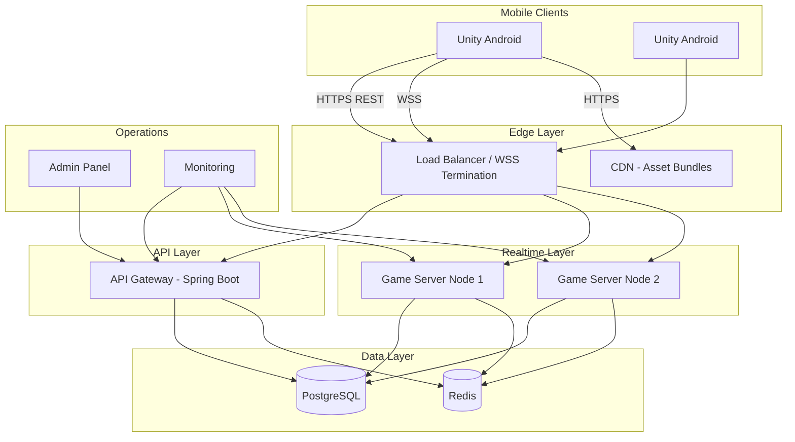
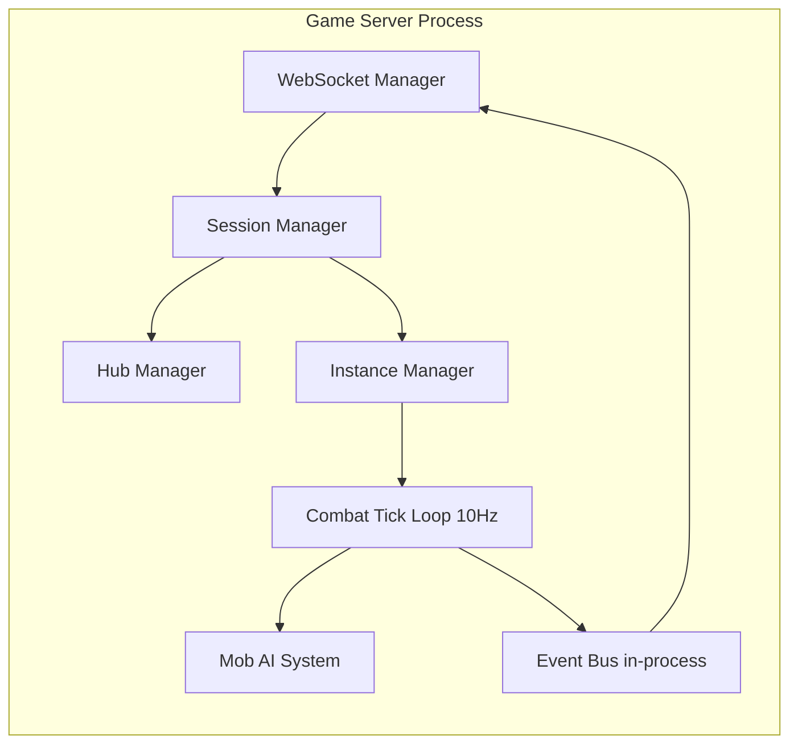
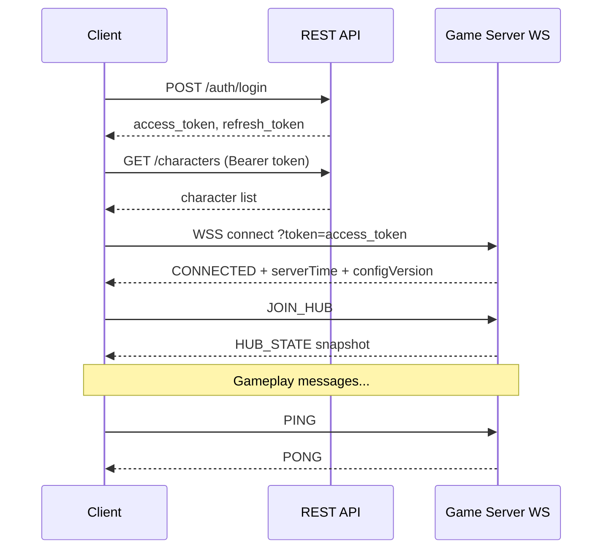
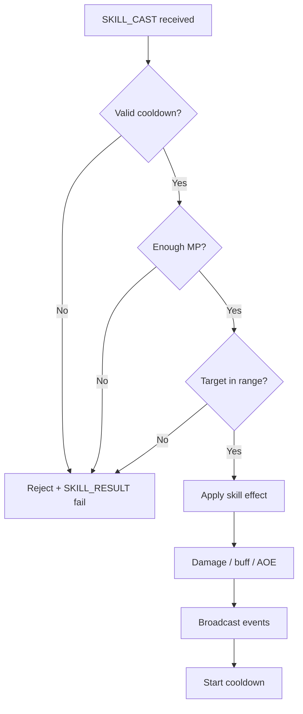
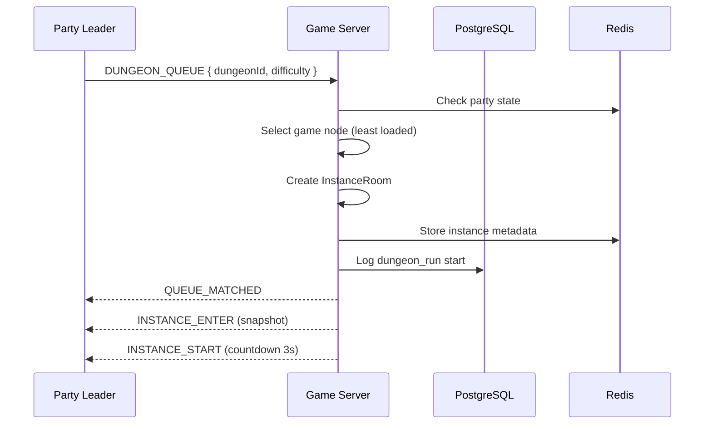
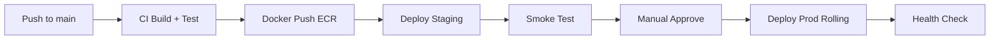

# Technical Design Document (TDD) v1

## Dungeon Delvers Online

| Thuộc tính | Giá trị |
|------------|---------|
| Version | 1.0 |
| Ngày | 2026-06-09 |
| Trạng thái | Draft — Vertical Slice → Alpha |
| Tác giả | Solo Dev + AI |
| Stack | Unity · Spring Boot · PostgreSQL · Redis · WebSocket |

---

## Mục lục

1. [Tổng quan](#1-tổng-quan)
2. [Nguyên tắc thiết kế](#2-nguyên-tắc-thiết-kế)
3. [Kiến trúc hệ thống](#3-kiến-trúc-hệ-thống)
4. [Kiến trúc server](#4-kiến-trúc-server)
5. [Thiết kế database](#5-thiết-kế-database)
6. [Redis & caching](#6-redis--caching)
7. [Networking & protocol](#7-networking--protocol)
8. [Combat system (kỹ thuật)](#8-combat-system-kỹ-thuật)
9. [Instance & matchmaking](#9-instance--matchmaking)
10. [Hub world](#10-hub-world)
11. [Kiến trúc Unity client](#11-kiến-trúc-unity-client)
12. [Bảo mật & anti-cheat](#12-bảo-mật--anti-cheat)
13. [Triển khai cloud](#13-triển-khai-cloud)
14. [Khả năng mở rộng](#14-khả-năng-mở-rộng)
15. [Observability](#15-observability)
16. [Performance targets](#16-performance-targets)
17. [Rủi ro kỹ thuật](#17-rủi-ro-kỹ-thuật)
18. [Phụ lục](#18-phụ-lục)

---

## 1. Tổng quan

### 1.1 Mục tiêu kỹ thuật

Dungeon Delvers Online là MMORPG co-op session-based trên mobile. Hệ thống phải:

- Hỗ trợ **~100 CCU** (Concurrent Users) tại MVP launch
- Hub tối đa **30 người/shard**; instance dungeon tối đa **4 người/phòng**
- **Server-authoritative** cho combat, loot, inventory, currency
- Latency chấp nhận được trên mạng di động (3G/4G, 80–200ms RTT)
- Triển khai trên **cloud**, có lộ trình scale horizontal khi vượt 500 CCU

### 1.2 Phạm vi TDD v1

| Trong phạm vi | Ngoài phạm vi (defer) |
|---------------|----------------------|
| Auth email/guest | OAuth social (Phase 2+) |
| 1 region cloud | Multi-region |
| Android primary | iOS (parallel track) |
| WebSocket realtime | UDP/custom netcode |
| 3 fixed + 1 procedural dungeon | Open world |
| Personal loot | Auction house / trade |

### 1.3 Tech stack

| Layer | Công nghệ | Version gợi ý |
|-------|-----------|---------------|
| Game Client | Unity (URP) | 2022.3 LTS |
| Client language | C# | .NET Standard 2.1 |
| API Server | Spring Boot | 3.2+ |
| Runtime | Java | 21 LTS |
| Database | PostgreSQL | 16 |
| Cache / PubSub | Redis | 7.x |
| Realtime | Spring WebSocket + STOMP hoặc raw WS | — |
| Container | Docker | — |
| CI/CD | GitHub Actions | — |
| Cloud | AWS hoặc GCP | 1 region |
| CDN | CloudFront / Cloud CDN | Asset patch |
| Monitoring | Prometheus + Grafana / CloudWatch | — |
| Error tracking | Sentry | Client + Server |

---

## 2. Nguyên tắc thiết kế

### 2.1 Server-authoritative

Client **không bao giờ** là nguồn sự thật cho:

- Damage dealt/received
- HP/MP thực tế
- Loot roll và item creation
- Gold/gem thay đổi
- Skill cooldown
- Vị trí cuối cùng khi có conflict

Client chỉ gửi **intent** (di chuyển, cast skill, interact). Server validate và broadcast kết quả.

### 2.2 Thin client, fat server logic

- Combat formula, drop table, quest progress: chạy trên server
- Client: render, prediction, interpolation, UI
- Game config (skill, mob, loot): JSON/DB, server load lúc startup + hot reload admin

### 2.3 Session-based MMO

```
Login → Hub (persistent shard) → Queue → Instance (ephemeral room) → Result → Hub
```

Instance được tạo/hủy theo nhu cầu. Hub tồn tại lâu dài theo shard.

### 2.4 Fail-safe defaults

- Disconnect instance: giữ slot 60s, cho reconnect
- Server crash instance: rollback loot chưa commit, refund energy nếu có
- Duplicate request: idempotent key trên action quan trọng

### 2.5 Solo-dev maintainability

- Monorepo hoặc 2 repo rõ ràng: `client/`, `server/`
- Config-driven content (không hardcode skill stats)
- Module hóa Spring Boot: `gateway`, `auth`, `game`, `admin`
- Tránh microservices sớm — **modular monolith** tới 500+ CCU

---

## 3. Kiến trúc hệ thống

### 3.1 High-level diagram



### 3.2 Luồng request

| Loại | Protocol | Mục đích |
|------|----------|----------|
| Auth, shop, inventory CRUD | HTTPS REST | Stateless, cacheable |
| Hub movement, chat, party | WebSocket | Low latency, persistent |
| Instance combat | WebSocket | Tick-based, room isolated |
| Asset download | HTTPS CDN | Addressables bundle |
| IAP receipt | HTTPS REST | Server validate Google Play |

### 3.3 Tách REST vs WebSocket

**REST** dùng cho: login, character create, load inventory, shop purchase, quest claim, leaderboard fetch.

**WebSocket** dùng cho: hub sync, party events, instance gameplay, chat realtime.

Lý do: gameplay cần persistent connection và message ordering trong room; REST phù hợp transactional operations.

---

## 4. Kiến trúc server

### 4.1 Modular monolith

```
server/
├── gateway/          # REST API, JWT filter, rate limit
├── auth/             # Register, login, token refresh
├── game-core/        # Shared domain models, config loader
├── game-hub/         # Hub shard manager, player presence
├── game-instance/    # Dungeon room, combat tick, AI
├── game-social/      # Party, guild, friend, chat
├── game-economy/     # Loot, craft, shop, currency
├── persistence/      # JPA repositories, migrations (Flyway)
└── admin/            # Internal ops API
```

Deploy ban đầu: **1 JAR duy nhất** chứa tất cả module. Tách process khi CCU > 300.

### 4.2 Process model (MVP 100 CCU)

| Process | Số lượng | Vai trò |
|---------|----------|---------|
| `api-gateway` | 1–2 instance | REST + WS accept, route tới game node |
| `game-server` | 2 instance | Hub + instance logic |
| PostgreSQL | 1 primary | Persistent data |
| Redis | 1 primary | Session, pub/sub, queue |

Ước tính tài nguyên MVP:

| Service | CPU | RAM |
|---------|-----|-----|
| API Gateway | 2 vCPU | 2 GB |
| Game Server ×2 | 2 vCPU each | 4 GB each |
| PostgreSQL | 2 vCPU | 4 GB |
| Redis | 1 vCPU | 1 GB |

### 4.3 Game Server internal architecture



### 4.4 Session Manager

Mỗi kết nối WebSocket map tới:

```
Session {
  sessionId: UUID
  accountId: UUID
  characterId: UUID
  connectionState: CONNECTED | RECONNECTING | DISCONNECTED
  currentZone: HUB | INSTANCE
  zoneId: string          // hub-shard-1 hoặc instance-uuid
  lastHeartbeat: timestamp
  messageSeq: int         // chống replay
}
```

Lưu `sessionId → Session` trong Redis (TTL 5 phút sau disconnect).

### 4.5 Hub Manager

- Mỗi hub shard chứa tối đa 30 `PlayerEntity` in-memory
- Broadcast vị trí mỗi **100ms** (10 Hz) trong interest radius **50m**
- Không có combat trong hub → không cần tick loop nặng
- Player join hub: assign shard có ít người nhất

### 4.6 Instance Manager

- Tạo `InstanceRoom` khi party leader start dungeon
- Room lifecycle:

```
CREATING → ACTIVE → COMPLETED | FAILED → DESTROYED
```

- Idle timeout: không có ai trong room 5 phút → DESTROYED
- Max concurrent instances per game-server node: **25** (MVP target)
- Mỗi room chạy `CombatTickLoop` riêng trên virtual thread (Java 21)

### 4.7 Tick loop (instance only)

| Thông số | Giá trị |
|----------|---------|
| Tick rate | 10 Hz (100ms) |
| Network broadcast | 10 Hz (có thể throttle mob xa) |
| Client send rate | 20 Hz movement intent |
| AI update | 10 Hz |

Tick order mỗi frame:

1. Process client intents (move, skill cast)
2. Validate cooldown / MP / range
3. Resolve skill effects + damage
4. Update mob AI
5. Check death / objective
6. Broadcast state delta
7. Persist checkpoint (mỗi 30s hoặc room end)

---

## 5. Thiết kế database

### 5.1 Nguyên tắc

- PostgreSQL là **single source of truth** cho persistent data
- Redis cache read-heavy, không thay thế durability
- Flyway migration versioned (`V001__init.sql`, ...)
- UUID primary key cho entity player-facing (chống enumerate)
- Soft delete cho account (`deleted_at`)
- Audit log cho currency và item rare

### 5.2 ER diagram (core)

```mermaid
erDiagram
    accounts ||--o{ characters : owns
    characters ||--o{ inventory_items : has
    characters ||--o{ equipment_slots : equips
    characters ||--o{ quest_progress : tracks
    characters ||--o{ friendships : has
    characters }o--o| guilds : joins
    guilds ||--o{ guild_members : contains
    characters ||--o{ leaderboard_entries : achieves
    accounts ||--o{ purchase_transactions : makes
    characters ||--o{ battle_pass_progress : progresses

    accounts {
        uuid id PK
        varchar email UK
        varchar password_hash
        varchar guest_device_id UK
        varchar status
        timestamptz created_at
    }

    characters {
        uuid id PK
        uuid account_id FK
        varchar name UK
        varchar class_type
        int level
        bigint xp
        int gold
        int premium_gems
        jsonb stats_json
        varchar current_zone
        timestamptz updated_at
    }

    inventory_items {
        uuid id PK
        uuid character_id FK
        varchar item_def_id
        int quantity
        varchar rarity
        int enhance_level
        boolean bound
        timestamptz created_at
    }

    equipment_slots {
        uuid character_id PK_FK
        varchar slot_type PK
        uuid inventory_item_id FK
    }
```

### 5.3 Bảng chi tiết

#### `accounts`

| Column | Type | Notes |
|--------|------|-------|
| id | UUID PK | |
| email | VARCHAR(255) UNIQUE | Nullable nếu guest |
| password_hash | VARCHAR(255) | bcrypt |
| guest_device_id | VARCHAR(128) UNIQUE | Nullable |
| status | VARCHAR(20) | ACTIVE, BANNED, SUSPENDED |
| created_at | TIMESTAMPTZ | |
| deleted_at | TIMESTAMPTZ | Soft delete |

#### `characters`

| Column | Type | Notes |
|--------|------|-------|
| id | UUID PK | |
| account_id | UUID FK | 1 char MVP, mở rộng 3 |
| name | VARCHAR(20) UNIQUE | |
| class_type | VARCHAR(20) | WARRIOR, MAGE |
| level | INT | 1–25 MVP |
| xp | BIGINT | |
| gold | INT | Soft currency |
| premium_gems | INT | Hard currency |
| stats_json | JSONB | HP, MP, ATK, DEF, CRIT base |
| hub_shard_id | VARCHAR(50) | Shard assign |
| last_login_at | TIMESTAMPTZ | |
| created_at | TIMESTAMPTZ | |

Index: `(account_id)`, `(name)`.

#### `inventory_items`

| Column | Type | Notes |
|--------|------|-------|
| id | UUID PK | Unique traceable item |
| character_id | UUID FK | |
| item_def_id | VARCHAR(50) | Reference config |
| quantity | INT | Stackable > 1 |
| rarity | VARCHAR(20) | COMMON, RARE, EPIC |
| enhance_level | INT | 0–3 |
| bound | BOOLEAN | Bind on equip |
| slot_index | INT | Inventory position |
| created_at | TIMESTAMPTZ | |

Index: `(character_id)`, `(character_id, item_def_id)`.

#### `equipment_slots`

| Column | Type | Notes |
|--------|------|-------|
| character_id | UUID FK | |
| slot_type | VARCHAR(20) | WEAPON, HELM, ... |
| inventory_item_id | UUID FK | |

PK: `(character_id, slot_type)`.

#### `quest_progress`

| Column | Type | Notes |
|--------|------|-------|
| id | UUID PK | |
| character_id | UUID FK | |
| quest_def_id | VARCHAR(50) | |
| status | VARCHAR(20) | ACTIVE, COMPLETED, CLAIMED |
| progress_json | JSONB | `{ "kills": 3 }` |
| assigned_at | TIMESTAMPTZ | Daily quest reset track |

Unique: `(character_id, quest_def_id, assigned_at::date)` cho daily.

#### `parties` (persistent party state — optional, chủ yếu Redis)

Lưu DB khi cần audit; runtime state ưu tiên Redis.

#### `guilds`

| Column | Type | Notes |
|--------|------|-------|
| id | UUID PK | |
| name | VARCHAR(30) UNIQUE | |
| tag | VARCHAR(5) UNIQUE | |
| leader_character_id | UUID FK | |
| max_members | INT | Default 30 |
| created_at | TIMESTAMPTZ | |

#### `guild_members`

| Column | Type | Notes |
|--------|------|-------|
| guild_id | UUID FK | |
| character_id | UUID FK UNIQUE | 1 guild/char |
| role | VARCHAR(20) | LEADER, OFFICER, MEMBER |
| joined_at | TIMESTAMPTZ | |

#### `leaderboard_entries`

| Column | Type | Notes |
|--------|------|-------|
| id | UUID PK | |
| season_id | VARCHAR(20) | |
| dungeon_def_id | VARCHAR(50) | |
| character_id | UUID FK | |
| clear_time_ms | INT | |
| party_size | INT | |
| achieved_at | TIMESTAMPTZ | |
| validated | BOOLEAN | Anti-cheat pass |

Index: `(season_id, dungeon_def_id, clear_time_ms)`.

#### `purchase_transactions`

| Column | Type | Notes |
|--------|------|-------|
| id | UUID PK | |
| account_id | UUID FK | |
| product_id | VARCHAR(100) | |
| store_transaction_id | VARCHAR(200) UNIQUE | Idempotent |
| receipt_hash | VARCHAR(64) | |
| amount_cents | INT | |
| currency_code | VARCHAR(3) | |
| status | VARCHAR(20) | PENDING, COMPLETED, REFUNDED |
| created_at | TIMESTAMPTZ | |

#### `currency_audit_log`

| Column | Type | Notes |
|--------|------|-------|
| id | BIGSERIAL PK | |
| character_id | UUID FK | |
| currency_type | VARCHAR(20) | GOLD, GEMS |
| delta | INT | +/- |
| balance_after | INT | |
| reason | VARCHAR(100) | LOOT, SHOP, CRAFT, ADMIN |
| ref_id | UUID | Item/quest reference |
| created_at | TIMESTAMPTZ | |

Append-only. Index `(character_id, created_at)`.

#### `item_audit_log`

Tương tự `currency_audit_log` cho item rare+ (RARE, EPIC).

### 5.4 Game config tables (data-driven)

Thay vì hardcode, lưu config có thể hot reload:

| Table | Mục đích |
|-------|----------|
| `item_definitions` | Base stat, slot, stackable |
| `skill_definitions` | Cooldown, MP, damage multiplier |
| `mob_definitions` | HP, ATK, AI profile |
| `dungeon_definitions` | Room layout ref, difficulty |
| `loot_tables` | Drop weight per mob |
| `recipe_definitions` | Crafting input/output |
| `quest_definitions` | Objective type, reward |
| `shop_catalog` | NPC vendor items |
| `battle_pass_tiers` | Season reward track |

Format `stats_json` / config: dùng JSONB + version field `config_version` để client biết cần refresh.

### 5.5 Migration strategy

- Flyway auto-run on deploy
- Backward-compatible migrations only (add column, không drop sớm)
- Seed data script cho item/skill/mob MVP
- Staging restore test trước mỗi production migration

---

## 6. Redis & caching

### 6.1 Use cases

| Key pattern | TTL | Mục đích |
|-------------|-----|----------|
| `session:{sessionId}` | 5m | WS session state |
| `presence:{characterId}` | 2m | Online status |
| `hub:shard:{id}:players` | — | Set character IDs in shard |
| `party:{partyId}` | 1h | Party member list, leader |
| `matchmaking:{dungeonId}:queue` | — | Sorted set by enqueue time |
| `instance:{instanceId}:state` | 2h | Room metadata snapshot |
| `ratelimit:{accountId}:{action}` | 1m | Rate limiting |
| `jwt:blacklist:{jti}` | token expiry | Logout invalidate |
| `leaderboard:{season}:{dungeon}` | 7d | Cached top 100 (ZSET) |
| `config:version` | 24h | Config cache bust |

### 6.2 Pub/Sub channels

| Channel | Publisher | Subscriber |
|---------|-----------|------------|
| `chat:hub:{shardId}` | Game server | All hub nodes |
| `chat:guild:{guildId}` | Game server | Members online |
| `party:{partyId}:events` | Game server | Party members |
| `admin:broadcast` | Admin | All game servers |

MVP single-region: 1 game-server node có thể bỏ pub/sub cross-node; bật khi scale 2+ nodes.

### 6.3 Cache invalidation

- Inventory thay đổi: xóa `inventory:{characterId}` cache
- Character equip: invalidate stat cache
- Config update admin: bump `config:version`, servers reload

### 6.4 Redis persistence

- AOF enabled cho matchmaking queue recovery
- Session data không critical — mất Redis = player reconnect

---

## 7. Networking & protocol

### 7.1 Transport

- **WebSocket Secure (WSS)** qua load balancer
- Binary payload: **JSON** (MVP) → migrate MessagePack khi bandwidth thành vấn đề
- Max message size: **64 KB**
- Heartbeat: client gửi `PING` mỗi 5s, server reply `PONG`; miss 3 lần → disconnect

### 7.2 Connection lifecycle



### 7.3 Message envelope

Mọi WS message theo format:

```json
{
  "type": "SKILL_CAST",
  "seq": 1042,
  "ts": 1717939200123,
  "payload": { }
}
```

| Field | Mô tả |
|-------|--------|
| type | Message type enum |
| seq | Client monotonic sequence (server detect gap) |
| ts | Client timestamp (debug, không dùng gameplay) |
| payload | Type-specific body |

Server response thêm:

```json
{
  "type": "DAMAGE_EVENT",
  "seq": 8821,
  "serverTs": 1717939200456,
  "payload": { }
}
```

### 7.4 Message types

#### Connection

| Type | Direction | Mô tả |
|------|-----------|-------|
| CONNECTED | S→C | Handshake OK |
| PING / PONG | C↔S | Heartbeat |
| ERROR | S→C | Code + message |
| KICK | S→C | Ban, maintenance |

#### Hub

| Type | Direction | Mô tả |
|------|-----------|-------|
| JOIN_HUB | C→S | Enter hub shard |
| HUB_STATE | S→C | Full snapshot |
| MOVE_INTENT | C→S | Position + rotation |
| ENTITY_UPDATE | S→C | Delta positions |
| ENTITY_SPAWN / DESPAWN | S→C | Player join/leave |
| CHAT_SEND | C→S | Message text |
| CHAT_MSG | S→C | Broadcast |

#### Party

| Type | Direction | Mô tả |
|------|-----------|-------|
| PARTY_CREATE | C→S | |
| PARTY_INVITE | C→S | targetCharacterName |
| PARTY_INVITE_NOTIFY | S→C | |
| PARTY_ACCEPT / DECLINE | C→S | |
| PARTY_UPDATE | S→C | Member list |
| PARTY_LEAVE / KICK | C→S | |
| DUNGEON_QUEUE | C→S | Leader only |
| QUEUE_UPDATE | S→C | Position, matched |

#### Instance

| Type | Direction | Mô tả |
|------|-----------|-------|
| INSTANCE_ENTER | S→C | Room snapshot |
| INSTANCE_START | S→C | Countdown |
| MOVE_INTENT | C→S | |
| SKILL_CAST | C→S | skillId, targetId, aimPos |
| SKILL_RESULT | S→C | Success/fail, cooldown |
| DAMAGE_EVENT | S→C | Source, target, amount, crit |
| ENTITY_DEATH | S→C | |
| BUFF_APPLY / BUFF_REMOVE | S→C | |
| OBJECTIVE_UPDATE | S→C | Kill count, boss phase |
| INSTANCE_COMPLETE | S→C | Rank, time, loot summary |
| REVIVE_START / REVIVE_CANCEL | C→S | |
| PLAYER_DOWNED | S→C | |

### 7.5 Movement sync

**Client-side prediction + server reconciliation**

1. Client di chuyển ngay khi input (prediction)
2. Gửi `MOVE_INTENT { pos, vel, rot, inputSeq }` 20 Hz
3. Server validate speed ≤ `maxSpeed * 1.1` tolerance
4. Server authoritative position mỗi 100ms
5. Nếu lệch > 1.5m: client snap hoặc smooth correct 200ms

**Hub**: tolerance rộng hơn (không combat).
**Instance**: tolerance chặt hơn.

### 7.6 Interest management (instance)

- Chia room thành grid 10m × 10m
- Chỉ broadcast entity trong cell hiện tại + 8 cell lân cận
- Player luôn nhận full state của party members bất kể distance

### 7.7 REST API (selected)

| Method | Path | Mô tả |
|--------|------|-------|
| POST | `/api/v1/auth/register` | |
| POST | `/api/v1/auth/login` | |
| POST | `/api/v1/auth/refresh` | |
| GET | `/api/v1/characters` | List |
| POST | `/api/v1/characters` | Create |
| GET | `/api/v1/characters/{id}/inventory` | |
| POST | `/api/v1/characters/{id}/equip` | |
| POST | `/api/v1/characters/{id}/craft` | |
| GET | `/api/v1/quests/daily` | |
| POST | `/api/v1/quests/{id}/claim` | |
| GET | `/api/v1/leaderboard/{dungeonId}` | |
| POST | `/api/v1/shop/purchase` | Gem shop |
| POST | `/api/v1/iap/verify` | Google receipt |
| GET | `/api/v1/config/game` | Config version + hash |
| GET | `/api/v1/friends` | |
| POST | `/api/v1/friends/add` | |

Response wrapper:

```json
{
  "success": true,
  "data": { },
  "error": null,
  "serverTime": 1717939200123
}
```

### 7.8 Ordering & reliability

- Trong 1 WS connection: ordered delivery (TCP)
- Skill cast: client `seq` + server ack; duplicate `seq` bị ignore
- Critical events (loot, instance complete): server gửi `ACK_REQUIRED`, client reply `ACK`
- Nếu không ACK trong 5s: server retry 3 lần

---

## 8. Combat system (kỹ thuật)

### 8.1 Stat model

```json
{
  "maxHp": 1000,
  "maxMp": 200,
  "atk": 50,
  "def": 30,
  "critRate": 0.05,
  "critDamage": 1.5,
  "moveSpeed": 5.0,
  "attackSpeed": 1.0
}
```

Final stat = `(base + gear + buff) * multiplier`

Tính trên server mỗi khi equip/buff thay đổi; cache trong `CombatEntity`.

### 8.2 Damage formula

```
rawDamage = skillBaseDamage + (ATK * skillScaling)
mitigated  = rawDamage * (100 / (100 + DEF))
if crit:   mitigated *= critDamage
finalDamage = floor(mitigated)
```

Minimum damage = 1. PvE only MVP — không có damage reduction PvP.

### 8.3 Auto-attack

- Range: 2.5m melee / 8m ranged (Mage)
- Tick check mỗi 100ms khi `inCombat` và có target
- Attack interval = `1 / attackSpeed` giây
- Target lock: server validate target còn sống và trong range

### 8.4 Skill execution pipeline



### 8.5 AOE & hit detection

- Hình học đơn giản: circle, cone, rectangle trên XZ plane
- Không dùng Unity physics server-side
- `EntityRegistry` in-memory per instance: O(n) scan chấp nhận được (max ~30 entity/room)

### 8.6 Buff / debuff

```
Buff {
  buffDefId: string
  sourceEntityId: UUID
  expiresAtTick: long
  stacks: int
  statModifiers: Map<Stat, float>
}
```

Server tick: mỗi 100ms giảm duration; hết hạn → remove + broadcast.

### 8.7 Mob AI (FSM)

```
States: IDLE → PATROL → CHASE → ATTACK → RETURN
```

| State | Điều kiện chuyển |
|-------|------------------|
| IDLE → CHASE | Player trong aggro radius 8m |
| CHASE → ATTACK | Trong attack range |
| ATTACK → CHASE | Target out of range |
| CHASE → RETURN | Target > leash 20m từ spawn |
| RETURN → IDLE | Về spawn point |

Boss thêm phase state overlay (HP threshold trigger).

### 8.8 Death & revive

- HP = 0 → `DOWNED` (player) hoặc `DEAD` (mob)
- Player downed: bleedout 30s; ally cast revive 3s → 30% HP
- Full party downed → `INSTANCE_FAILED` sau 5s
- Mob death → loot roll ngay, broadcast `ENTITY_DEATH`

---

## 9. Instance & matchmaking

### 9.1 Tạo instance



### 9.2 Procedural dungeon generation

Server-side seed-based:

```
seed = hash(partyId + timestamp)
rooms = graphGenerator(seed, minRooms=4, maxRooms=7)
mobSpawns = populateFromRules(rooms, difficulty)
```

Client nhận `roomLayoutSeed + roomTemplateIds[]` → build scene từ prefab templates.

Đảm bảo: cùng seed → cùng layout (replay, debug).

### 9.3 Loot distribution

**Personal loot** (MVP):

- Mỗi player roll bảng riêng khi mob die / chest open
- Item vào inventory ngay (hoặc temp bag nếu full → mail defer)
- Epic drop: ghi `item_audit_log`

### 9.4 Instance result persistence

Khi `INSTANCE_COMPLETE`:

1. Validate clear time ≥ minimum (anti-speed)
2. Write `dungeon_run` record
3. Update quest progress
4. Award XP, gold
5. Update leaderboard nếu Hard mode + valid
6. Destroy room sau 60s (cho xem result screen)

---

## 10. Hub world

### 10.1 Shard strategy

- MVP: **2 hub shard** × 30 player = 60 visible + buffer
- Assign shard: `hash(characterId) % shardCount` hoặc least-populated
- Không cross-shard visibility (giảm complexity)

### 10.2 Hub entity sync

| Entity | Sync | Rate |
|--------|------|------|
| Player | Position, rot, anim state | 10 Hz |
| NPC | Static (không sync) | — |
| Emote | Event trigger | On demand |

### 10.3 Chat

- Hub global: rate limit 5 msg / 10s / player
- Profanity filter: word list server-side
- Max message 200 chars
- Guild chat: Redis pub/sub tới members online

---

## 11. Kiến trúc Unity client

### 11.1 Project structure

```
Assets/
├── _Project/
│   ├── Scenes/           # Boot, Login, Hub, Dungeon
│   ├── Scripts/
│   │   ├── Core/         # GameManager, ServiceLocator
│   │   ├── Network/      # WS client, REST client, message handler
│   │   ├── Gameplay/     # Combat, skills, mob
│   │   ├── UI/           # Screens, HUD
│   │   ├── Data/         # ScriptableObjects mirror config
│   │   └── Utils/
│   ├── Prefabs/
│   ├── Art/
│   └── AddressableAssets/
```

### 11.2 Core systems

| System | Trách nhiệm |
|--------|-------------|
| `NetworkService` | WS connect, send, receive, reconnect |
| `RestApiService` | Auth, inventory, shop |
| `GameStateMachine` | Boot → Login → Hub → Dungeon |
| `EntityManager` | Spawn/despawn remote players, mobs |
| `PredictionController` | Local player movement |
| `InterpolationController` | Remote entity smooth |
| `CombatPresenter` | VFX, damage numbers (cosmetic) |
| `ConfigManager` | Load game config, version check |
| `AudioManager` | BGM, SFX |

### 11.3 Update loops

- `Update`: input, camera, UI
- `FixedUpdate` (50 Hz): gửi movement intent
- Network receive: thread pool → main thread queue (ConcurrentQueue)

### 11.4 Reconnection

```
Disconnect detected
  → Show "Reconnecting..."
  → Exponential backoff: 1s, 2s, 4s, 8s (max 30s)
  → Re-WS connect with refresh token
  → SEND RECONNECT { lastKnownSeq, zoneId }
  → Server resend state snapshot
  → Resume
```

Nếu instance đã kết thúc: redirect hub + show result mail.

### 11.5 Addressables

- Hub scene + dungeon templates: remote bundle
- Initial APK: Boot + Login only (< 150 MB target)
- Patch qua CDN khi `configVersion` thay đổi

---

## 12. Bảo mật & anti-cheat

### 12.1 Authentication

- JWT access token: 15 phút
- Refresh token: 7 ngày, rotate on use
- WS connect: validate JWT trước khi accept
- HTTPS/WSS only; TLS 1.2+

### 12.2 Input validation

Mọi client message:

- Schema validate (type, required fields, range)
- Rate limit per action type
- Reject nếu `seq` < last processed (replay)
- Timestamp chỉ dùng debug, không dùng gameplay logic

### 12.3 Anti-cheat (MVP)

| Cheat | Detection | Action |
|-------|-----------|--------|
| Speed hack | Position delta > max speed | Warning → kick |
| Damage hack | Client không gửi damage | Server-only (prevented) |
| Cooldown skip | Skill cast khi CD active | Reject + log |
| Loot dupe | Duplicate ACK / replay | Idempotent item ID |
| Clear time invalid | Below human minimum | Leaderboard reject |

Không có kernel anti-cheat MVP. Log suspicious → admin review.

### 12.4 IAP security

- Google Play receipt validate server-side với Google API
- `store_transaction_id` UNIQUE — duplicate return same result (idempotent)
- Grant gems chỉ sau `COMPLETED`

### 12.5 Admin access

- Admin API: separate port hoặc IP whitelist
- Role: `ADMIN`, `MODERATOR`
- Mọi grant item / ban: audit log bắt buộc

---

## 13. Triển khai cloud

### 13.1 Environment

| Env | Mục đích | URL pattern |
|-----|----------|-------------|
| dev | Local + cloud dev | dev.api.dungeondelvers.local |
| staging | QA, load test | staging.api... |
| prod | Live | api.dungeondelvers.com |

### 13.2 AWS reference architecture (tương đương GCP)

| Component | Service |
|-----------|---------|
| Compute | ECS Fargate hoặc EC2 |
| LB | ALB (HTTPS + WSS) |
| DB | RDS PostgreSQL |
| Cache | ElastiCache Redis |
| CDN | CloudFront |
| Secrets | AWS Secrets Manager |
| Logs | CloudWatch Logs |
| DNS | Route 53 |

### 13.3 Deploy flow



- Rolling deploy: max 1 instance down
- DB migration: chạy trước deploy (backward compatible)
- Maintenance mode: admin flag → KICK all + banner

### 13.4 Health check

- `GET /health` → 200 + `{ "status": "UP", "ccu": 42 }`
- ALB check mỗi 30s
- WS: separate TCP check hoặc HTTP upgrade endpoint

---

## 14. Khả năng mở rộng

### 14.1 Scale stages

| CCU | Kiến trúc |
|-----|-----------|
| 0–100 | 1 API + 2 game server, 1 DB |
| 100–300 | 2 API + 3 game server, Redis pub/sub cross-node |
| 300–1000 | Tách instance service riêng, read replica DB |
| 1000+ | Multi-region, dedicated matchmaking service |

### 14.2 Bottleneck dự kiến

1. **Game server CPU** (combat tick) — scale horizontal instance nodes
2. **PostgreSQL write** (loot log) — batch write, async audit
3. **WebSocket connection count** — thêm game server node + sticky session

### 14.3 Sticky session

Load balancer affinity theo `characterId` hash → cùng hub shard về cùng node.

### 14.4 DB scaling

- MVP: single primary
- Read replica cho leaderboard, profile fetch
- Connection pool HikariCP: max 20 per instance
- Không sharding DB trước 10K DAU

---

## 15. Observability

### 15.1 Metrics

| Metric | Alert threshold |
|--------|-----------------|
| `ccu_current` | Info |
| `ws_connections` | — |
| `instance_count` | — |
| `tick_duration_ms` p99 | > 50ms |
| `api_latency_ms` p95 | > 300ms |
| `error_rate` | > 1% |
| `db_pool_active` | > 80% |

### 15.2 Logging

- Structured JSON: `timestamp, level, service, traceId, accountId, message`
- Gameplay log sample 1% (debug)
- Error always 100%

### 15.3 Tracing

- `traceId` generate tại API gateway, propagate WS messages
- Correlation: login → dungeon start → complete

### 15.4 Client analytics events

| Event | Properties |
|-------|------------|
| `login` | accountId |
| `tutorial_step` | stepId |
| `dungeon_start` | dungeonId, partySize |
| `dungeon_complete` | dungeonId, timeMs, success |
| `purchase` | productId, amount |
| `session_end` | durationSec |

---

## 16. Performance targets

### 16.1 Server (100 CCU)

| Metric | Target |
|--------|--------|
| API p95 latency | < 200ms |
| WS message handling p99 | < 30ms |
| Combat tick jitter | < 10ms |
| Instance creation | < 2s |
| Uptime | 99.5% |
| Max concurrent instances/node | 25 |

### 16.2 Client (mid-range Android)

| Metric | Target |
|--------|--------|
| FPS hub | ≥ 30 |
| FPS dungeon | ≥ 30 |
| FPS boss fight | ≥ 25 |
| Initial download | < 150 MB |
| Total install | < 500 MB |
| Memory | < 1.2 GB |
| Session load (login → hub) | < 8s |

### 16.3 Network

| Metric | Target |
|--------|--------|
| Bandwidth per player hub | < 30 KB/s |
| Bandwidth per player instance | < 60 KB/s |
| Reconnect time | < 5s |

---

## 17. Rủi ro kỹ thuật

| ID | Rủi ro | Mức | Mitigation |
|----|--------|-----|------------|
| R1 | WS desync mobile high latency | Cao | Prediction + reconciliation; instance 4p only |
| R2 | Solo dev overload scope | Cao | Modular monolith; config-driven; defer microservices |
| R3 | DB write bottleneck loot log | Trung bình | Async batch audit; sample common drops |
| R4 | Redis single point of failure | Trung bình | Reconnect logic; session rebuild from DB |
| R5 | Procedural dungeon bug / soft-lock | Trung bình | Fixed dungeon first; seed replay tool |
| R6 | IAP fraud | Trung bình | Server receipt validate; idempotent |
| R7 | Cheat speed/teleport | Trung bình | Server position validate; kick threshold |
| R8 | Deploy breaks WS connections | Thấp | Rolling deploy; client auto-reconnect |
| R9 | JSON bandwidth cao | Thấp | MessagePack migration path Phase 3 |
| R10 | Flyway migration prod fail | Trung bình | Staging test; backward compatible only |

---

## 18. Phụ lục

### 18.1 Độ khó module (kỹ thuật)

| Module | Độ khó (1–5) | Phase |
|--------|--------------|-------|
| Auth + JWT | 2 | P0 |
| REST API scaffold | 2 | P0 |
| WebSocket gateway | 4 | P0 |
| Movement sync | 4 | P0–P1 |
| Combat tick server | 4 | P0–P1 |
| Instance manager | 4 | P1 |
| Hub sync | 3 | P1 |
| Party / matchmaking | 3 | P1–P2 |
| Inventory persistence | 3 | P0–P2 |
| Loot system | 3 | P1–P2 |
| Procedural dungeon | 4 | P2 |
| Guild + chat | 3 | P2 |
| IAP + receipt | 3 | P3 |
| Admin panel | 2 | P2 |
| Load test 100 CCU | 3 | P2 |
| Anti-cheat | 4 | P2–P3 |

### 18.2 Open decisions (cần chốt khi implement)

| # | Quyết định | Đề xuất MVP |
|---|------------|-------------|
| 1 | WS framework: raw vs STOMP | Raw JSON (đơn giản hơn) |
| 2 | Cloud: AWS vs GCP | AWS (tài liệu nhiều hơn) |
| 3 | Energy/stamina system | Không có MVP — chơi không giới hạn |
| 4 | Cross-shard hub | Không — 2 shard độc lập |
| 5 | Binary protocol | JSON → MessagePack khi cần |

### 18.3 Tài liệu liên quan

| Tài liệu | Path | Trạng thái |
|----------|------|------------|
| Doc Index | `docs/README.md` | Ready |
| GDD v1 | `docs/GDD-v1.md` | Ready |
| Product Roadmap | `docs/roadmap.md` | Ready |
| Economy Design | `docs/economy-design.md` | Ready |
| Phase 0 Checklist | `docs/phase-0-checklist.md` | Ready |
| API Spec OpenAPI | `docs/api/openapi.yaml` | Ready |
| HTTP Examples | `docs/api/http-examples.md` | Ready |
| Network Protocol | `docs/network-protocol.md` | Ready |
| Game Config Spec | `docs/game-config-spec.md` | Ready |
| Setup Guide | `docs/setup-guide.md` | Ready |
| Coding Conventions | `docs/coding-conventions.md` | Ready |
| Project Structure | `docs/project-structure.md` | Ready |
| Unity Client Guide | `docs/unity-client-guide.md` | Ready |
| DB Migration V001 | `server/.../V001__init_schema.sql` | Ready |
| DB Seed V002 | `server/.../V002__seed_config.sql` | Ready |
| Shared Config JSON | `shared/config/` | Ready |
| ADRs | `docs/decisions/` | Ready |

### 18.4 Revision history

| Version | Date | Changes |
|---------|------|---------|
| 1.0 | 2026-06-09 | Initial TDD — architecture, DB, networking, combat, deploy |

---

*TDD v1 là living document. Cập nhật sau Phase 0 prototype với số đo latency và bottleneck thực tế.*
